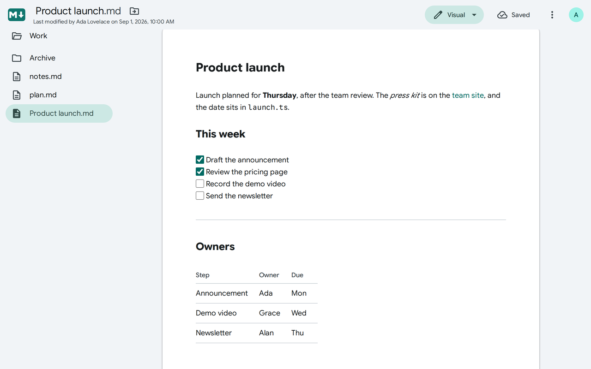

# DriveMD

Browse, view and edit the Markdown files in Google Drive, on desktop and on phones (iPhone first, Android too), including notes in Obsidian vaults.



DriveMD is a static web app for a Google Workspace organization. It signs in with Google, calls the Drive API straight from the browser, with no server of its own, and never rewrites a file it did not change. Edgeweave builds it in the open and runs it for its own organization; another organization runs its own copy, as [Running your own](#running-your-own) explains.

## Status

Milestones 1 to 7 are done; milestone 8, mobile polish, waits for its checks on an Android phone, and milestone 9, the interface redesign, is under way. The product spec, [`docs/SPEC.md`](docs/SPEC.md), is the source of truth, and its build plan drives the work one milestone at a time. How the interface looks, with its tokens and mockups, is in [`docs/DESIGN.md`](docs/DESIGN.md).

- **Milestone 1, sign-in.** The app signs in with Google and shows the signed-in account's email, CI deploys `dev` to staging, and sign-in passed the test on a real iPhone without a token backend.
- **Milestone 2, the Drive client.** `src/drive.ts` is the typed Drive client that the next milestones build on, tested against mocked Drive answers.
- **Milestone 3, the file navigator**, checked on the real Drive in real browsers and on a real iPhone. Once signed in, the app opens on Home, which shows the Markdown files opened last and the Obsidian vaults in Drive, and from which My Drive, Shortcuts, Shared drives and Shared with me open, then their folders one after the other, listing their folders and Markdown files and following shortcuts, and greying out those whose target is gone. Breadcrumbs show the path taken, or the one rebuilt from Drive for a page opened by its address, and a search box on every page finds Markdown files by name in every drive, saying when Drive left some drives out. **New** creates a Markdown file in a folder where the user may add files, asking for its name first, and a file's page can rename it or move it to another folder, warning first when it sits in an Obsidian vault, or move it to Drive's trash once the user confirms. On a wide screen, a file's page lists its folder beside it; on a tablet held upright, **Folder** opens that list in a drawer. Each page has its own address (see the spec's file navigator).
- **Milestone 4, the viewer and editor**, checked on the real Drive in real browsers and on a real iPhone: saving a note changes only the lines edited, a file with Windows line breaks or a byte order mark is written back byte for byte, and a file that is not UTF-8 opens read-only. A file opens on its own page, which says who changed it last and shows it rendered as GitHub renders Markdown, with tables, task lists, footnotes, highlighted code, sanitized HTML and front matter as a table of properties; a file over 1 MB, or one the user may not download, leads to Google Drive instead, and a badge says why a file is read-only. Relative links lead where their path does in Drive, from the note's folder: to a note or a folder in the app, to another file in Google Drive, and a link to nothing is faded. Relative images show from Drive, up to 10 MB; images on other sites are not loaded: each is a link that opens it in a new tab. **Edit** opens the note's source in CodeMirror, beside the preview on a wide screen or a tablet and in its place on a phone, with Markdown highlighting and front matter as YAML, lists continued on Enter, Find in note, and Cmd/Ctrl+click to follow a link. A tap on a task's checkbox, in the viewer or the preview, checks or unchecks it, and **Save**, or Cmd/Ctrl+S, writes the note back: only if its bytes changed, once Drive confirms nobody else changed it since (when someone did, the page shows the differences and lets the user keep Drive's version, overwrite it, or save theirs as a copy), and keeping the revision from before the first edit in the file's version history. Unsaved changes are kept on the device as the user types, and reopening the note offers them back; offline, a save fails at once and says to check the connection, as does any other write to Drive; Home lists the notes that have some first, and lets the user discard those of a note that no longer opens. Leaving a note with unsaved changes asks first.
- **Milestone 5, Obsidian vaults**, checked on the real Drive in real browsers, and compared with Obsidian's reading view on a real iPhone, on a made-up test vault. A link to a note's heading, `plan.md#next-steps`, opens the note there. A note in an Obsidian vault shows as Obsidian shows it: a single line break shows as one, unless the vault's settings join lines as Markdown does, callouts show in their type's color, after its icon, folded or open when they fold, with Obsidian's chevron, highlights, tags and inline footnotes show, checked tasks are struck through, and comments and block IDs do not. Internal links, `[[Note]]` and Markdown links alike, lead where Obsidian's do: a name anywhere in the vault, nearest first, at the heading or block they name. Embedded images, `![[image.png|300]]`, show from Drive at the size they give, embedded notes show inline, the section or block they name, three deep at most, and other embeds are links.
- **Milestone 6, routing and links**, checked on the real Drive in real browsers, and Drive's New page on a real iPhone: each address opens the right file after sign-in. A file's `/edit?id=…` opens it, with its resource key, and so does a Drive link pasted in the search box, to a file or a folder. Drive's **Open with** address, `/open?state=…`, gives way to the file's own once the app starts, and the tab has the user pick the account to sign in with, starting from the one Drive used. Drive's **New**, `/new?state=…`, asks for the new note's name, saying which folder Drive named, creates it there and opens it. Drive itself sends these addresses once the app is listed, at milestone 7.
- **Milestone 7, Drive integration and production**, checked in Drive on the web, on a computer and on an iPhone. Production, https://md.corp.edgeweave.tech, is deployed by CI from `main`, beside staging. DriveMD has a private Google Workspace Marketplace listing, installed for the organization: **Open with** on a .md file in Drive on the web, in a computer's or a phone's browser, opens it in DriveMD, after a sign-in through Google's account chooser, and so does a double click once DriveMD is the user's default app for it. Drive's own **New** does not offer DriveMD, since Drive now creates Markdown files itself and opens them in Google Docs, and Drive's phone apps do not open web apps. The sign-in screen links to `/about.html`, the privacy, terms and support page that the listing links to, and the browser tab shows DriveMD's icon.
- **Milestone 9, the interface redesign**, under way, after `docs/DESIGN.md`: DriveMD takes the look of Google's Workspace apps, in Google Sans Flex and Google Sans Code, which the app serves itself, Material Design 3's colors from its icon's teal, and Material Symbols. The app bar leads with DriveMD's mark, which leads Home, searches from a pill, and shows the account as its initial, whose menu holds About DriveMD and Sign out; on a phone, a button opens the search full screen. On a wide screen, a navigation drawer beside Home, folders and search lists My Drive, Shortcuts, Shared drives, Shared with me and the vaults, and on a tablet a navigation rail does, its Vaults item opening a menu of them, so that Home shows the notes with unsaved changes and Recent. Recent shows the 10 notes opened last, and the rest after **Show all**, folded again each time Home opens from another page. Each row shows what it is by its icon, and says when and by whom the item last changed: in a column of its own on a wide screen, under its name on a phone. Recent and search results also give the folder each note sits in, which Drive names as each row comes near the screen. On a phone, a folder names itself in the app bar, with a way up to the folder above, and offers **New note** as a floating button; breadcrumbs show on folder pages only. On a wide screen, a note shows on a sheet, as Docs shows a page, and in Source, the source and the preview on two sheets side by side. A note names itself in the app bar, which holds no search but its mode menu, as in Docs, **Visual** editing the note on one sheet, **Source** showing the source beside the preview and **Viewing** the note alone, once saved, and **Save**, **Save** saying Saved, Save or Saving… in the same place, a task ticked while viewing saving at once, as on GitHub, while the browser tab's title starts with • as long as changes are unsaved, with who last changed it and when under its name, **Move** beside the name and **Move to trash** in a More actions menu. A click on the name renames the note, its `.md` ending kept out of the field, Enter or leaving the field renaming it and Escape cancelling; in an Obsidian vault, a dialog first warns that links to it will not follow; on a phone, its bar leads Back to its folder instead of Home, keeps **Move** in More actions, while **Edit** floats over the note and a check in place of Back saves and ends editing, as Viewing does, and leaves out the last change and the account. A note reads in the design's type, its headings at 500 without GitHub's rules and its tables ruled as Drive lists files. A tab that Drive's **Open with** opened holds its note alone, in the editor on a wide screen and in reading on a phone, through a reload, until another address of the app is typed in it: DriveMD's mark leads nowhere, and takes Back's place on a phone, no folder shows beside the note, a note moved to the trash stays, saying where it went, and on a phone More actions holds the account's email, About DriveMD and Sign out. A link to another note opens it in a new tab, in the same mode and without asking to sign in again, since the browser copies the tab's session into it; a browser that blocks the tab opens the note in place. When someone else changed a note before a save, a banner says who and when, over the differences in Google Sans Code on a sheet, and offers saving a copy first, then overwriting, then keeping Drive's version, which asks again. On a phone or a tablet, DriveMD follows the system's light or dark theme; on a computer, it stays light, as Docs does on the web.
- **v2, the live preview**, under way, after the spec's last section: the editor has three modes. **Visual**, editing's default, edits the note on one sheet, **Source** shows the source in light styling beside its preview, and **Viewing** reads the note, saving first; on a phone, a segmented button switches between Visual, Source and Preview. The device remembers the mode chosen last between Visual and Source. Visual hides a heading's `#`, emphasis' `*` and `_`, strikethrough's `~~`, inline code's backticks and an inline link's brackets and address, but on the lines being written, and draws a bullet list's markers as bullets, a task's as its box, which a tap ticks, and a thematic break as a rule, a table as the viewer does, which a tap shows as written, the cursor in the cell tapped, and a quote with its bars, without its `>`, as callouts too for now; images show as in Source for now.

## Signing in

**Sign in with Google** opens Google's window, so the browser must allow pop-ups for the site. The session then lasts about an hour for the tab: a reload keeps it, while a new tab or a relaunch of the Home Screen app asks for **Continue**, which renews it for the account remembered on the device, usually with a window that closes by itself. Once the hour is up, the next tap that opens a page renews the session in the same way, and a page that loads without a tap asks for **Continue**. The sign-in screen is a card on a wide screen; in a tab that Drive's **Open with** opened, it says that Google Drive asked DriveMD to open a note. A tab that Drive's **Open with** or **New** opens asks to **Sign in** rather than **Continue**, with Google's account chooser starting from the account Drive used, and the account picked becomes the one remembered on the device. **Sign out** forgets the session on the device, in every open tab, without revoking DriveMD's access to the Google account. It also discards the unsaved changes kept on the device for the account, after saying how many notes have some.

The sign-in screen links to `/about.html`, which says what DriveMD does with your data, its terms of use, where to report a problem and where its source code is, without signing in. Once signed in, the round button with the account's initial, at the end of the app bar but for a note's on a phone, opens a menu with the account's address, **About DriveMD**, which opens that page in a new tab, or in a second window of the Home Screen app, **Sign out** and the version running: `0.8.0` in production, and `0.8.0-beta.12+abc1234` on staging or from a local build, where 12 counts the commits since the latest release before 0.8.0 and `abc1234` names the build's commit (the count is left out when git lacks that release's tag or commits). The about page has a **Close** button, which goes back or closes the tab or window.

When a new version of DriveMD is deployed, a page left open, a tab or the Home Screen app, says **A new version of DriveMD is ready** under the app bar as it shows again, within a quarter of an hour while it stays on screen, or as soon as a part of the app it has not loaded yet is no longer served. **Reload** loads the new version and **Later** puts it off, while the account's menu still offers **Reload to update**. Neither shows while a note has unsaved changes, nor offline, and DriveMD never reloads by itself. The build writes its version to `/version.json`, which the page compares with its own.

## On a phone

On an iPhone, Safari's **Share > Add to Home Screen** puts DriveMD on the Home Screen, with its icon, as a banner on Home says until you tap **Got it**; on Android, Chrome offers **Install app** (or **Add to Home screen**). DriveMD then opens on Home, in a window of its own, from whatever page of the app it was added. On a phone with a notch or a home bar, the app's bars, pages and buttons stay clear of them, held upright or sideways. On a phone, the magnifier in the app bar opens the search full screen, with Back and Clear. Once installed on Android, DriveMD is offered in the share sheet: a shared link to a Drive file or folder, or to a page of DriveMD, opens there, even with words around it. Its web app manifest is `public/manifest.webmanifest`; its icons are `public/icon.svg` and, for launchers that round or cut icons to their own shape, `public/icon-maskable.svg`, rendered as PNG files beside them.

## Editing on a touch screen

On a phone or a tablet, a row of keys sits above the keyboard while the note's source has the focus: **Undo**, **Redo**, **Heading** (`#`, `##`, `###`, then text again), **Bold**, **List**, **Checkbox** (an open task, a done one, then a plain list item again), **Link** (or **Open link**, which opens the link the cursor is in), **Indent** and **Outdent** (one level of a list, lined up with the text of the item above, with tabs where the list already uses tabs, as Obsidian's do; a numbered item that would otherwise run on as the text above it becomes `1.`, the only character other than spaces and tabs they change, since only a list starting at 1 breaks into a paragraph, and Undo brings its number back; an item nests in the preview once it has text; the iPhone keyboard has no Tab key, and Cmd/Ctrl+] and Cmd/Ctrl+[ do the same on a computer), and **Find in note**. The row scrolls sideways when it does not fit, and its keys keep the keyboard up. The note's end, the line being typed and a line tapped half under it stay clear of it, and the note's app bar, with Done and Save, stays on the screen meanwhile. **Find in note** takes the app bar's place on a phone, and sticks under it on a wider screen, wherever the cursor is in the note: it counts the matches, steps through them, matches case, whole words or a regular expression, and replaces them; Cmd/Ctrl+F opens it too. With a mouse, the row does not show. In the source, the phone neither corrects words, adds capitals nor curls quotes. Two spaces typed after a word, Markdown's line break at a line's end, stay two spaces, where the keyboard's "." shortcut would turn them into a period and a space.

## Stack

Vite, React and TypeScript; Google Identity Services and the Drive REST API v3, with TanStack Query caching Drive's answers; CodeMirror 6 for editing and react-markdown for rendering; Firebase Hosting. The spec explains each choice.

## Running your own

DriveMD serves one Google Workspace organization, so each organization runs its own copy, from a Google Cloud project of its own. [`docs/self-hosting.md`](docs/self-hosting.md) explains why, and how to configure, build, deploy and list it in Drive's **Open with**.

## Development

```sh
pnpm install
pnpm run dev
```

[`docs/development.md`](docs/development.md) gives the commands, the end-to-end tests, the live Drive checks, the device checks and how releases are made.

## Security

The app's access token can read and write the user's whole Drive, so the app runs under a strict Content Security Policy with Trusted Types, and the repository guards its supply chain, as [`docs/development.md`](docs/development.md#supply-chain-and-code-safety) lists.

## Contributing

[`CONTRIBUTING.md`](CONTRIBUTING.md) says how to propose a change, and [`SECURITY.md`](SECURITY.md) how to report a vulnerability, privately. Issues and pull requests are public: leave out real file names, addresses and notes. Everyone who takes part follows the [code of conduct](CODE_OF_CONDUCT.md).

## License

Copyright 2026 Edgeweave.

DriveMD is free software: you can redistribute it and/or modify it under the terms of the GNU Affero General Public License as published by the Free Software Foundation, either version 3 of the License, or (at your option) any later version. DriveMD is distributed in the hope that it will be useful, but without any warranty; without even the implied warranty of merchantability or fitness for a particular purpose. See [`LICENSE`](LICENSE) for the full terms.

The app's icon draws the Markdown mark by Dustin Curtis, which he dedicated to the public domain. The icons in its pages, the keyboard toolbar's among them, are Google's [Material Symbols](https://github.com/google/material-design-icons), under the [Apache License 2.0](LICENSES/Apache-2.0.txt), whose text `LICENSES/Apache-2.0.txt` holds, but for those in a callout's title in an Obsidian vault, its type's icon and the chevron that folds it: Obsidian's own, [Lucide](https://lucide.dev)'s, under the ISC License, some of them from [Feather](https://github.com/feathericons/feather), under the MIT License, both in `LICENSES/Lucide.txt`, copied from lucide-static 1.26.0. Its fonts are [Google Sans Flex](https://fonts.google.com/specimen/Google+Sans+Flex), copyright 2015 Google LLC, and [Google Sans Code](https://github.com/googlefonts/googlesans-code), copyright 2025 The Google Sans Code Project Authors, both under the [SIL Open Font License 1.1](LICENSES/OFL-1.1.txt), whose text `LICENSES/OFL-1.1.txt` holds; the app serves them itself, from the `@fontsource-variable` packages.
