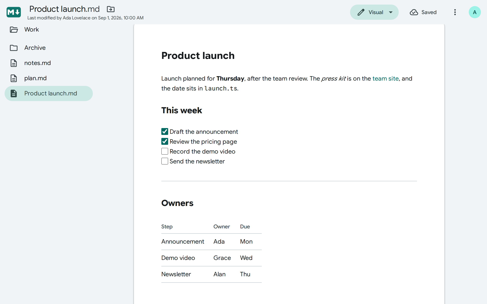
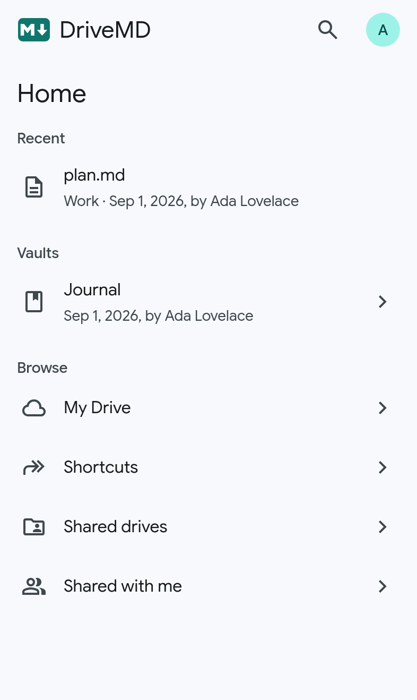
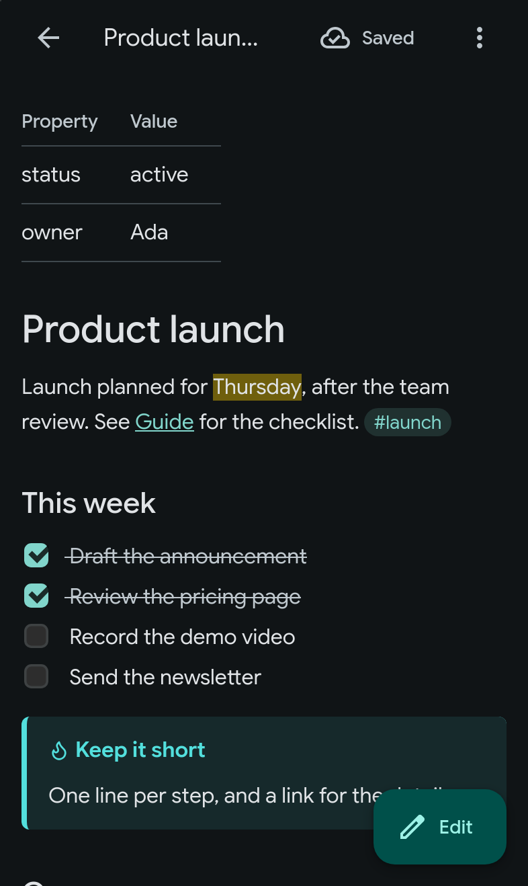
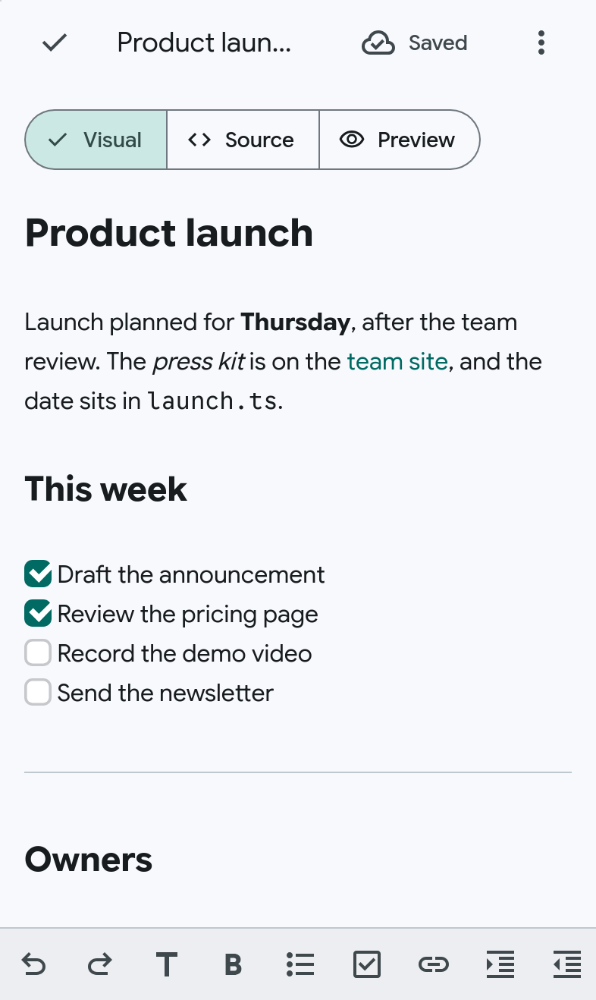

# DriveMD user guide

DriveMD opens the Markdown files in your Google Drive, reads them as GitHub or Obsidian shows them, and edits them without changing anything you did not touch. This guide walks through it task by task; [`SPEC.md`](SPEC.md) gives the exact rules behind each behavior.

- [Before you start](#before-you-start)
- [Signing in](#signing-in)
- [Finding your way around](#finding-your-way-around)
- [Finding a note](#finding-a-note)
- [Reading a note](#reading-a-note)
- [Editing a note](#editing-a-note)
- [Saving, and what keeps your work safe](#saving-and-what-keeps-your-work-safe)
- [Creating, renaming, moving and trashing](#creating-renaming-moving-and-trashing)
- [Obsidian vaults](#obsidian-vaults)
- [Opening notes from Google Drive](#opening-notes-from-google-drive)
- [On a phone or a tablet](#on-a-phone-or-a-tablet)
- [Keyboard shortcuts](#keyboard-shortcuts)
- [Your data](#your-data)
- [Updates](#updates)
- [Limits](#limits)
- [Troubleshooting](#troubleshooting)

## Before you start

You need:

- A Google account in the organization that runs your copy of DriveMD. Accounts from other organizations, and personal Gmail accounts, cannot sign in.
- A recent browser: Chrome, Safari, Edge or Firefox on a computer; Safari on an iPhone or an iPad; Chrome or Samsung Internet on Android.
- Pop-ups allowed for DriveMD's site, since Google's sign-in opens in a window of its own.

DriveMD reads and writes your files in Google Drive itself: there is nothing to import, and every change you save is in Drive at once, for every other app and device.

## Signing in

1. Open DriveMD's address and tap **Sign in with Google**.
2. In Google's window, pick your account and allow DriveMD to see and edit your Drive files.
3. DriveMD opens on **Home**.

The session lasts about an hour, for that tab. A reload keeps it. A new tab, or the Home Screen app launched again, asks you to tap **Continue**, which renews it for the account the device remembers, usually in a window that closes by itself. Once the hour is up, the next page you open renews it the same way.

The round button with your initial, at the end of the app bar, opens the account menu: your address, **About DriveMD**, **Sign out**, and the version running. **Sign out** forgets the session in every tab of that browser, and discards the unsaved changes the device keeps for your account, after telling you how many notes have some. It does not remove DriveMD's access to your Google account.

**About DriveMD**, also linked from the sign-in screen as **Privacy, terms and support**, says what DriveMD does with your data, its terms of use, where to report a problem and where its source code is.

## Finding your way around

- **The app bar**, at the top, holds DriveMD's mark, which leads Home, the search box, and the account button. On a note, it holds the note's name instead, with who last changed it and when, the mode menu, **Save**, **More actions** (⋮) and the account button; on a phone, Back to the folder takes the mark's place, and the last change and the account are left out.
- **The navigation drawer**, on a computer or a tablet held sideways, lists Home, My Drive, Shortcuts, Shared drives, Shared with me and your Obsidian vaults. On a tablet held upright, a narrower **navigation rail** does, its **Vaults** item opening a menu of them. On a phone, Home lists them.
- **A note's folder** shows beside it on a computer or a tablet held sideways; on a tablet held upright, **Folder** opens it in a drawer.

On a phone or a tablet, DriveMD follows the system's light or dark theme. On a computer, it stays light, as Google Docs does on the web.

## Finding a note

### From Home

**Home** shows, from the top:

- **Unsaved changes**: the notes whose changes you have not saved yet, the latest first, when there are any.
- **Recent**: the 10 Markdown files you opened last, on any device, then the rest after **Show all**.
- **Vaults**: the Obsidian vaults in your Drive, on a phone.
- **Browse**: My Drive, Shortcuts, Shared drives and Shared with me, on a phone.

### By browsing

Open **My Drive**, **Shortcuts** (the shortcuts you made, outside shared drives), **Shared drives** or **Shared with me**, then folders one after the other. A folder lists its folders first, then its Markdown files (`.md` and `.markdown`), each sorted by name, `file2` before `file10`. Each row says when and by whom the item last changed. Folders and files whose name starts with a dot, such as `.obsidian`, are hidden.

Shortcuts open what they point to, and a shortcut whose target is gone is greyed out. Breadcrumbs above a folder show the path you took, or the one Drive gives for a page you opened by its address.

### By searching

Type in the search box on Home, a folder or a search, or tap the magnifier on a phone. DriveMD finds Markdown files by name, in every drive you can reach:

- It matches the start of words: "plan" finds `planning.md` and `Q3 plan.md`, but not `myplan.md`.
- Every word you type must match, whatever its case, accented letters included.
- It shows the files among Drive's first 100 matches, the most recently changed first, and says when Drive left some drives out of its search.

DriveMD searches names only, not what notes hold.

### By a link

- **A Drive link** pasted in the search box, to a file or a folder, opens it instead of searching.
- **DriveMD's own addresses** can be bookmarked and shared: each page has one, such as `/edit?id=…` for a note or `/folder/…` for a folder. Back and a reload keep your place.

## Reading a note

A note opens for reading, rendered as GitHub renders Markdown: headings, emphasis, lists, tables, task lists, footnotes, highlighted code blocks, and HTML, with anything unsafe removed. Front matter shows as a table of properties at the top. Math and Mermaid diagrams show as written.

- **Tasks.** Tap a task's box to tick or untick it: the note saves at once.
- **Links.** A relative link leads where its path does in Drive, from the note's folder: to a note or a folder in DriveMD, to any other file in Google Drive. A link to a heading, `plan.md#next-steps`, opens the note there. A relative link that leads nowhere is faded. Links to websites open in a new tab.
- **Images.** Images stored in Drive show, up to 10 MB each. Images on other websites are not loaded: each shows as a link that opens it in a new tab, so that a note cannot make DriveMD contact another server.

A note may open **read-only**, with a badge that says why: you may only view or comment on it, it is locked, it is not UTF-8 text, or it mixes line breaks. A file over 1 MB, or one you may not download, shows a link to open it in Google Drive instead.

## Editing a note

On a computer or a tablet, pick a mode from the mode menu in the app bar. On a phone, tap **Edit**, then pick a mode from the segmented button over the note.

| Mode                                                | What it shows                                                                                                                                                                                                                                                                                                                                                              |
| --------------------------------------------------- | -------------------------------------------------------------------------------------------------------------------------------------------------------------------------------------------------------------------------------------------------------------------------------------------------------------------------------------------------------------------------- |
| **Visual**                                          | The note as it reads, on one sheet, and editable. Headings, emphasis, strikethrough, inline code and links hide their Markdown symbols except on the line you are writing; bullets, task boxes, rules, tables, quotes and code blocks are drawn, a code block's fences showing while you write in it. Tap a task's box to tick it, and a table's cell to edit it in place. |
| **Source**                                          | The Markdown as written, lightly styled, beside its preview on a computer or a tablet.                                                                                                                                                                                                                                                                                     |
| **Viewing** (computer, tablet), **Preview** (phone) | The rendered note alone. Viewing saves the note first.                                                                                                                                                                                                                                                                                                                     |

The device remembers whether you last chose Visual or Source, and opens the editor in it next time. Switching between them keeps your cursor and your undo history. Images, and Obsidian's own syntax, show in Visual as they do in Source for now.

While editing:

- **Enter** continues a list or a task list.
- In a table's cell, in Visual, **Tab** moves to the next cell, **Shift+Tab** to the one before, and **Enter** to the one below; **Tab** in the last cell, and **Enter** with no cell below, add a row. The arrow keys move from cell to cell, and out of the table at its edges; from the line above or below a table, they move into its cells. **Shift+Enter** starts a new line in the cell, written ` `, which the table shows as a new line once you leave the cell; on a phone or a tablet, tap **Table options** in the keyboard toolbar, then **Insert line break**. **Escape** shows the table's Markdown. A `|` you type is written `\|`, so that it stays in its cell.
- **Right-click** a table's cell, in Visual, for the table's menu: start a new line in the cell, as **Shift+Enter** does, add a row above or below it, or a column to its left or right, move its row or its column, delete them, or align its column left, center or right: Markdown aligns a whole column, never a single cell. On a phone or a tablet, the keyboard toolbar shows the frequent ones as keys while you edit a cell, and its **Table options** key opens the menu with the others. DriveMD writes only the lines that change, never realigning the table's columns, and **Undo** takes each change back on its own.
- A table in a quote, or in a callout, is drawn and edited the same way. Its lines keep their `>` as you wrote them, and a row you add takes those of the line next to it.
- **Find in note**, from Cmd/Ctrl+F or the keyboard toolbar, counts the matches, steps through them, matches case, whole words or a regular expression, and replaces one match or all of them.
- **Cmd/Ctrl+click** on a link opens it.
- To finish, pick **Viewing** on a computer or a tablet, or tap the check in Back's place on a phone: both save first.

## Saving, and what keeps your work safe

Tap **Save**, or press Cmd/Ctrl+S. **Save** reads **Saving…**, then **Saved**, and the browser tab's title starts with • while changes are unsaved. There is no autosave to Drive.

DriveMD is built never to damage a file:

- **Only your edits change.** A save writes only if the text changed, and changes only the lines you edited. A file with Windows line breaks or a byte order mark is written back exactly as it was, apart from your edits.
- **Someone else's changes are never lost.** Before saving, DriveMD checks that nobody changed the note since you opened it. If someone did, a banner says who and when, over the differences between their version and yours, and you choose: **Save mine as a copy** (`<name> (conflict).md`, in the same folder), **Overwrite with mine**, their version staying in the file's version history, or **Keep the Drive version**, which asks you to confirm since your changes then go.
- **The version before your edits is kept.** Before the first save of an editing session, DriveMD keeps the note's current revision forever in its Drive version history (**File information ▸ Manage versions** in Drive), until someone deletes it there.
- **Unsaved changes survive.** As you type, DriveMD keeps your changes on the device, so that they survive a reload, a crash or the phone closing the app. Reopening the note offers them back; Home lists every note that has some. A note that no longer opens, deleted or no longer shared for example, offers **Discard** from Home.
- **Leaving asks first.** Leaving a note with unsaved changes for another page of DriveMD asks you first, and the browser asks before a reload or closing the tab. On an iPhone, and with the browser's Back, it may not ask: the changes kept on the device are the safety net.

Offline, a save fails at once and says to check the connection, as does any other change to Drive: nothing waits to run later.

## Creating, renaming, moving and trashing

- **New note**, in a folder where you may add files, asks for a name, then creates the note there and opens it. On a phone, it is the floating button.
- **Rename** a note by clicking its name in the app bar. Its `.md` ending stays out of the field; **Enter** or leaving the field renames it, and **Escape** cancels.
- **Move**, beside the note's name (in **More actions** on a phone), opens a folder picker at the note's folder.
- **Move to trash**, in **More actions**, asks you to confirm. The note stays in Drive's trash, from which Drive restores it.

Each action shows only when your rights in Drive allow it. In an Obsidian vault, renaming and moving warn first that links to the note will not be updated: only Obsidian updates them, when it renames a note itself.

## Obsidian vaults

A folder holding an `.obsidian` folder is a vault. Inside it, notes show as Obsidian's reading view shows them:

- A single line break shows as one, unless the vault's settings join lines as Markdown does.
- Callouts show in their type's color, after its icon, folded or open as they say, and a tap on a folded one's title opens it.
- `==Highlights==`, `#tags` and inline footnotes `^[…]` show; `%%comments%%` and block IDs `^id` do not; checked tasks are struck through.
- Internal links, `[[Note]]`, `[[Note#Heading]]`, `[[Note#^block]]` and Markdown links alike, lead where Obsidian's do: to a note of that name in the note's folder first, otherwise anywhere in the vault, the shortest path first.
- Embedded images, `![[image.png|300]]`, show at the size they give. Embedded notes, `![[Note#Section]]`, show inline, three deep and ten to a note at most; past that, and for other files, an embed is a link.

Plugins' syntax, such as Dataview, Tasks or Templater, shows as written.

## Opening notes from Google Drive

When your organization's administrator has installed DriveMD from the Google Workspace Marketplace, in Drive on the web:

1. Right-click a `.md` file, or tap ⋮ beside it.
2. Pick **Open with ▸ DriveMD**.
3. Sign in: Google's account chooser starts from the account Drive uses.

To open `.md` files in DriveMD with a double click, make it the default app in Drive's **Settings ▸ Manage apps**. Drive's **New** menu does not offer DriveMD, since Drive creates Markdown files itself and opens them in Google Docs: use **New note** in DriveMD. Drive's iPhone app does not open web apps: open the note in DriveMD, or paste its link there. On Android, the Drive app's **Open with** offers DriveMD, which opens the note in Chrome.

A tab that Drive opened shows the note in the editor on a computer or a tablet, in the mode you chose last, and for reading on a phone. It holds that note alone, through a reload, until you type another of DriveMD's addresses in it: no folder or search shows. A link to another note opens it in a new tab, in the same mode, without signing in again; if the browser blocks the tab, the note opens in place. Moving the note to the trash there leaves the tab open, saying that the note is in the trash.

## On a phone or a tablet

  
  
  

### Installing DriveMD

- **iPhone and iPad:** in Safari, tap **Share ▸ Add to Home Screen**, as a banner on Home reminds you until you tap **Got it**.
- **Android:** in Chrome, tap ⋮ ▸ **Add to home screen** ▸ **Install**.

DriveMD then opens on Home, in a window of its own, clear of the notch, the camera and the home bar, upright or sideways. Installed on Android, it shows in the share sheet: share a link to a Drive file or folder, or to a page of DriveMD, even with words around it, and it opens there.

### The keyboard toolbar

While you edit on a touch screen, a row of keys sits above the keyboard. It scrolls sideways when it does not fit, which a key cut in half under a shade at its edge shows, and its keys keep the keyboard up. In a table's cell, the keys that change lines (Heading, List, Checkbox, Indent and Outdent) give way to the table's keys, after **Undo** and **Redo**, and **Table options** stays at the row's right end; tap another cell to move to it.

| Key                                               | What it does                                                                                                                                    |
| ------------------------------------------------- | ----------------------------------------------------------------------------------------------------------------------------------------------- |
| **Undo**, **Redo**                                | Take back or redo one change                                                                                                                    |
| **Heading**                                       | `#`, `##`, `###`, then text again                                                                                                               |
| **Bold**                                          | Wraps the selection in `**`, or takes it away                                                                                                   |
| **List**                                          | Adds or removes a `- ` bullet                                                                                                                   |
| **Checkbox**                                      | An open task, a done one, then a plain list item again                                                                                          |
| **Link**, **Open link**                           | Makes the selection a link; in a link, opens it                                                                                                 |
| **Indent**, **Outdent**                           | Moves a list item one level in or out, lined up with the item above, with tabs where the list uses tabs                                         |
| **Find in note**                                  | Opens the find bar: in the app bar's place on a phone, under it on a tablet                                                                     |
| **Add row below**, **Delete row**                 | In a table's cell, adds a row under its row, or deletes its row                                                                                 |
| **Add column to the right**, **Delete column**    | In a table's cell, adds a column after its column, or deletes its column                                                                        |
| **Align left**, **Align center**, **Align right** | In a table's cell, aligns its column; the column's own is highlighted                                                                           |
| **Table options**                                 | In a table's cell, opens the table's menu with the rest: a new line in the cell, a row above, a column to the left, and moving rows and columns |

The line you type stays clear of the toolbar, and so does the note's end. The phone neither corrects words, adds capitals nor curls quotes in a note, so that what you type is what is saved, and two spaces after a word, Markdown's line break, stay two spaces rather than becoming a period.

On Android, Back steps back through folders and notes as in any app.

## Keyboard shortcuts

On a Mac, use Cmd; elsewhere, Ctrl.

| Shortcut                              | Action                                         |
| ------------------------------------- | ---------------------------------------------- |
| Cmd/Ctrl+S                            | Save the note                                  |
| Cmd/Ctrl+F                            | Find in note, while editing                    |
| Cmd/Ctrl+click                        | Open the link under the pointer, while editing |
| Cmd/Ctrl+B                            | Bold, while editing                            |
| Cmd/Ctrl+K                            | Make a link, while editing                     |
| Cmd/Ctrl+Shift+8                      | Make a list, or plain text, while editing      |
| Cmd/Ctrl+Shift+9                      | Make a task, then tick it, while editing       |
| Cmd/Ctrl+Z                            | Undo, while editing                            |
| Cmd+Shift+Z (Mac), Ctrl+Y (elsewhere) | Redo, while editing                            |
| Cmd/Ctrl+]                            | Indent a list item, while editing              |
| Cmd/Ctrl+[                            | Outdent a list item, while editing             |
| Right-click, Shift+F10 (not on a Mac) | The table's menu, on a table's cell in Visual  |
| Enter, Escape (renaming)              | Rename the note, or cancel                     |

## Your data

DriveMD has no server of its own: your browser talks to Google directly, and what your notes hold goes between your browser and Google Drive, nowhere else. It sets no cookies of its own, has no analytics or ads, and changes only what you ask it to, besides marking the notes you open as viewed, so that they show in Recent on every device.

Your device keeps:

- the tab's session, for about an hour, in that tab only;
- your account's address, to offer **Continue** next time;
- the changes you have not saved yet, with the note's name, until you save or discard them;
- whether you last chose Visual or Source, and whether you dismissed the Add to Home Screen banner.

**Sign out** removes the first three for your account, in that browser. The browser's history keeps the addresses of the pages you opened, which name Drive files and folders. Firebase Hosting, which serves DriveMD's files, sees the address of each page you load, which can name a Drive file or folder, and your network address, as any web host does, but never what your notes hold. **About DriveMD**, in the account menu, says the same in full, with the terms of use.

## Updates

When a new version of DriveMD is deployed, an open page says **A new version of DriveMD is ready** under the app bar, as it shows again or within a quarter of an hour. **Reload** loads the new version; **Later** puts it off, and the account menu keeps offering **Reload to update**. Neither shows while a note has unsaved changes, nor offline, and DriveMD never reloads by itself. The account menu shows the version running.

## Limits

- Search finds notes by name, not by what they hold.
- Files over 1 MB open in Google Drive instead; images over 10 MB show as links.
- Math, Mermaid diagrams and Obsidian plugins' syntax show as written.
- Nothing saves offline, and DriveMD has no real-time collaboration: the conflict banner settles changes made at the same time.
- Renaming or moving a note does not update the links to it in other notes.
- Google Docs files do not open in DriveMD.

## Troubleshooting

| What happens                           | What to do                                                                                                                                                          |
| -------------------------------------- | ------------------------------------------------------------------------------------------------------------------------------------------------------------------- |
| **Sign in with Google** does nothing   | Allow pop-ups for DriveMD's site, then tap it again.                                                                                                                |
| The page asks **Continue**             | The session ended, or this is a new tab: tap **Continue**.                                                                                                          |
| Your account cannot sign in            | Only accounts of the organization that runs this copy can: sign in with your work account.                                                                          |
| A note is read-only                    | Its badge says why: ask its owner for edit access, or to unlock it. A note that is not UTF-8 or mixes line breaks DriveMD only shows: edit it elsewhere.            |
| A note says it opens in Google Drive   | It is over 1 MB, or you may not download it.                                                                                                                        |
| An image shows as a link               | It is on another website, over 10 MB, one you may not download, one the browser cannot decode, or not an image DriveMD shows (PNG, JPEG, GIF, WebP, AVIF or BMP).   |
| A link is faded                        | Nothing in Drive is at its path, from the note's folder.                                                                                                            |
| Search misses a note                   | Search matches the start of words in names: try the name's first word, or browse to it.                                                                             |
| A save says to check the connection    | You are offline: your changes stay on the device; save once the connection is back.                                                                                 |
| A banner says someone changed the note | Pick how to settle it: a copy is the safest.                                                                                                                        |
| **Open with** does not offer DriveMD   | Your organization has not installed it from its Marketplace, or you are in Drive's iPhone app: open the note in DriveMD, or paste its Drive link in the search box. |

Something else? Report it as **About DriveMD** says, with a made-up note that shows the problem, never a real one: the project's issues are public.
